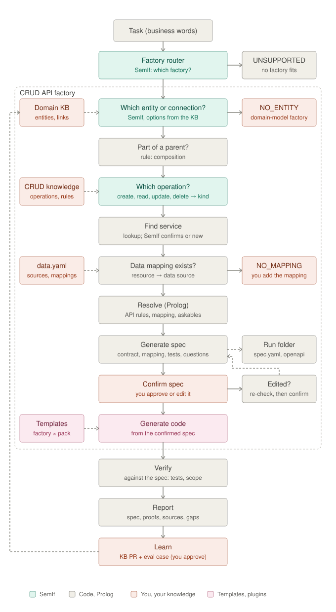

# harness

**Build backend APIs from tasks written in business language: deterministic where it can be, AI where it must be, approved by you where it matters.**

> **Status: early development.** Today the CRUD API factory **understands** a task (classify), knows **where the data lives** (data mapping) and **designs** the API as a spec you can review (resolve). Generating the code from a design you confirm comes next (stage S5 in the [plan](docs/plan.md)).

## What you get

You describe your business once, in YAML: what it has (`domain.yaml`) and where it is stored (`data.yaml`). Then for a task like *"Let staff add a new publisher through a new endpoint"* the harness:

1. **classifies** it: which factory, entity, operation and kind, and whether an API already exists, with a trace that explains every step;
2. **designs** the API: path, parameters, body, response, errors, data operations, delete effects, each value with the rule it came from;
3. *(S5)* writes a **spec** for you to confirm, then **generates, verifies and reports** the code.

A small decision model ([SemIf](https://github.com/TheoLeeCJ/SemIf-OpenJev)) reads the task; [Prolog](https://www.swi-prolog.org/) rules derive the design; nothing is guessed: what's unclear comes back to you.

## Quick start (with the sample Bookstore project)

Requires [uv](https://docs.astral.sh/uv/) and [SWI-Prolog](https://www.swi-prolog.org/) (macOS: `brew install swi-prolog`).

```bash
git clone https://github.com/mitesh-tech/harness.git
cd harness
uv sync
```

Check the sample project's knowledge:

```bash
uv run harness validate -p examples/bookstore
```

Design an existing API (no decision model needed):

```bash
uv run harness resolve --service add_review -p examples/bookstore
```

```yaml
api:
  method: POST
  path: /books/{book_id}/reviews
  path_params: { book_id: { type: id, refers_to: Book } }
  request: { fields: { rating: { type: integer, required: true, min: 1, max: 5 }, comment: … } }
  response: { status: 201, shape: item, headers: [Location], … }
  errors:
  - { status: 404, when: no Book has this book_id, rule: not-found }
  - { status: 422, when: invalid or missing fields, rule: invalid-body }
data: { source: bookstore_db, table: reviews, parent_key: book_id, operation: insert_row, … }
sources:
  api.path: rule collection-path
  …
```

Classify a task (needs SemIf running, see [Running SemIf](#running-semif)):

```bash
uv run harness classify "Let staff add a new publisher through a new endpoint" -p examples/bookstore
```

## Use it in your project

### 1. Install the harness

```bash
uv tool install "harness[prolog,relational] @ git+https://github.com/mitesh-tech/harness"
```

`prolog` runs the logic rules (needs SWI-Prolog); `relational` lets the harness read your database's tables (`validate --introspect`).

### 2. Link your project

Add `harness.yaml` at the project root:

```yaml
version: 1
pack: python-fastapi        # the stack the code is generated for
knowledge: .harness         # where your domain.yaml and data.yaml live
harness: ">=0.0.1"          # optional: harness versions this project works with
```

Run `harness …` anywhere inside the project (it finds `harness.yaml` in the folder or a parent), or point at it with `-p path/to/project`. Your project never points at the harness.

```
your-project/
├── harness.yaml
├── .harness/
│   ├── domain.yaml         # WHAT the business has
│   ├── data.yaml           # WHERE it is stored
│   ├── evals/classify.yaml # optional: tasks and expected results
│   └── factories/crud-api/technical.yaml   # optional: your overrides
└── app/                    # your app; generated code goes here (S5)
```

### 3. Describe your domain: `.harness/domain.yaml`

```yaml
description: "an online bookstore"      # the business, in a few words

areas:
  catalogue: { description: "Books for sale and who publishes them" }

entities:
  Book:
    area: catalogue
    description: "A book for sale in the store"
    identifier: id
    attributes:
      id:     { type: id, generated: true }
      title:  { type: text, required: true }
      price:  { type: money, required: true, min: 0 }
    summary: [title, price]              # what a list shows for each book

associations:
  book_publisher:
    kind: aggregation                    # or composition: the child can't exist alone
    parent: Publisher
    child: Book
    cardinality: one_to_many
    on_delete: restrict                  # or set_null

services:                                # the APIs you already have
  add_book: { description: "Add a new book", kind: create, acts_on: Book }
```

See the full [Bookstore domain](examples/bookstore/.harness/domain.yaml).

### 4. Say where the data lives: `.harness/data.yaml`

```yaml
sources:
  bookstore_db:
    type: relational
    connection:
      url_env: BOOKSTORE_DATABASE_URL     # from the environment: no secrets in YAML
      default_url: sqlite:///./bookstore.db

entities:
  Book:
    source: bookstore_db
    table: books
    columns: { id: id, title: title, price: price, status: status }

relationships:
  book_publisher: { source: bookstore_db, column: books.publisher_id }
```

See the full [Bookstore data.yaml](examples/bookstore/.harness/data.yaml).

### 5. Check it

```bash
harness validate                # syntax, shape, references and logic, with file and line
harness validate --introspect   # also compare data.yaml with the real database
```

### 6. Classify a task

Write the task in business language and **name the endpoint** ("…through a new endpoint"):

```bash
harness classify "Let staff add a new publisher through a new endpoint" --trace
```

```
  step         by     answer                      conf  margin
  factory      semif  crud-api                    0.93    0.90  ✓
  target       semif  Publisher                   0.86    0.81  ✓
  parent       rule   none                       Publisher is not part of another thing
  data         rule   bookstore_db               Publisher is stored in bookstore_db (relational), table publishers
  operation    semif  create                      1.00    1.00  ✓
  kind         rule   create                     the only kind of create that works on Publisher
  service      rule   none                       no service acts on Publisher with kind create
  name         rule   add_publisher              kind create names new services add_{entity}

Outcome   NEW_SERVICE: Publisher › bookstore_db › create › create › add_publisher
```

| Outcome | Means | You |
|---|---|---|
| `MATCHED` | an existing service does this | resolve it |
| `NEW_SERVICE` | a new API, named by rule | resolve it |
| `UNSURE` | SemIf isn't sure enough | decide |
| `NO_ENTITY` | the domain has nothing that fits | change the domain first |
| `NO_MAPPING` | `data.yaml` doesn't say where it's stored | add its entry |
| `UNSUPPORTED` | no factory handles it (or only a planned one, like domain changes) | out of scope for now |

### 7. Design the API: a spec to review

```bash
harness resolve "Readers should be able to change their rating of a book through a new endpoint"
```

```
Service   change_review_rating (new)
API       PATCH /books/{book_id}/reviews/{review_id}
Open      Does the task change the comment of a Review? (SemIf 0.32)
Saved     .harness/runs/20261015-130930-4d0c/spec.yaml, openapi.yaml, trace.jsonl
```

`resolve` classifies the task; for a **new** service it asks SemIf yes/no questions about the details the task states (which attributes change, which filters a list has), and anything SemIf isn't sure about becomes an **open question** instead of a guess. Then it designs the API and saves a run folder (kept out of git automatically):

| File | What it is |
|---|---|
| `spec.yaml` | the design: API, data, delete effects, tests to verify it, open questions, and the source of every value; the only input to code generation (S5), after you confirm it |
| `openapi.yaml` | the same API as an OpenAPI 3.1 document, made from the spec, for Swagger UI, client generators and contract tests |
| `trace.jsonl` | every decision, from classification to design |

`harness resolve --service add_book` designs an existing service without SemIf. The design follows the [CRUD factory's design decisions](docs/factories/crud-api.md#design-decisions): the identifier is a path parameter, query parameters only filter and page lists, a list shows each item's summary, composition children are nested, deletes cascade or are restricted by your `on_delete`.

## Customising

| You want to… | Do this |
|---|---|
| add or change entities, attributes, relationships, list summaries, delete policies | edit `.harness/domain.yaml` |
| change where something is stored | edit `.harness/data.yaml` |
| change a convention for every API (singular paths, `offset`/`limit` paging, status codes) | override `api:` in `.harness/factories/crud-api/technical.yaml` |
| change what a kind does, or a rule | override `kinds:` / `rules:` there, or drop a rule with `remove_rules: [id]` |
| make one API different | `api: { path: "/legacy/items" }` on that service in `domain.yaml` |

Start an override from the factory's current entry instead of copying by hand:

```bash
harness override kinds.delete      # or api.paths, rules.lists-are-paged, …
```

Overrides contain only what differs; `harness validate` lists the override file and points errors at its lines. Logic checks (a cascade loop, two APIs on the same path) can't be switched off. Every value in a design names its source, so an override is easy to spot.

## Commands

| Command | Does |
|---|---|
| `harness validate [--introspect] [--strict]` | check the project's knowledge (and data sources) |
| `harness classify "task" [--trace] [-v] [--json] [--trace-out f]` | classify a task, with an explained trace |
| `harness resolve "task"` / `--service NAME` | design the API and save a spec, an OpenAPI document and the trace in `.harness/runs/<id>/` |
| `harness override SECTION.NAME` | start a project override from the factory's entry |
| `harness eval classify` | run the project's eval cases against SemIf |
| `harness kb query "goal"` / `harness kb export` | ask the knowledge as Prolog, or export it |
| `harness semif check` | check the decision model is running |
| `harness schema export` | write JSON Schemas for editor autocomplete |

Editors with YAML support (e.g. VS Code with the YAML extension) give autocomplete and inline errors from the schemas in [schemas/](schemas/).

## Running SemIf

Classification uses SemIf through the HTTP server from [SemIf-server](https://github.com/someka-vrc/SemIf-server). Install it once (macOS, Apple Silicon):

```bash
git clone https://github.com/someka-vrc/SemIf-server ~/.harness/semif
cd ~/.harness/semif && uv venv --python 3.12 .venv && uv pip install --python .venv/bin/python -e '.[mlx]'
```

Start it (the first start downloads Qwen3.5-4B; it needs about 9 GB of memory, so close memory-heavy apps):

```bash
~/.harness/semif/.venv/bin/semif-serve --model Qwen/Qwen3.5-4B \
  --revision 851bf6e806efd8d0a36b00ddf55e13ccb7b8cd0a --backend mlx --port 8010
```

Then `harness semif check`. The address, threshold and timeout go in `harness.yaml` under `semif:`.

## Evals

Put tasks and their expected results in `.harness/evals/classify.yaml` ([example](examples/bookstore/.harness/evals/classify.yaml)): the outcome, and optionally the answers, the path of steps, steps that must not be asked, the most SemIf calls, and paraphrase groups that must agree. Then:

```bash
harness eval classify
```

Each failure names the first wrong step.

## How it works



The harness is a platform of small **software factories**, each turning a task into one kind of verified code. A router picks the factory; the first one, the [CRUD API factory](docs/factories/crud-api.md), classifies the task, resolves the design and (S5) generates and verifies the code. Planned factories (domain model, data model, auth) are already known to the router, so tasks for them are recognised instead of mistaken for CRUD.

- **Deterministic first:** facts and rules before AI, AI before guessing, and a person for anything unsure.
- **SemIf reads; Prolog decides:** SemIf turns language into facts; Prolog turns facts into decisions, each with its rule.
- **Plugins:** factories, stack packs and data-source types are folders, not code changes.

More: [architecture](docs/architecture.md), [plan](docs/plan.md), [CRUD factory and its design decisions](docs/factories/crud-api.md).

## Developing the harness

```bash
uv sync
uv run pytest
uv run ruff check . && uv run ruff format --check .
uv run harness validate --strict -p examples/bookstore
```

Tests replay real SemIf answers recorded in `tests/recordings/`, so they run without the server. After changing what SemIf reads (questions, descriptions, options), re-record with SemIf running: `uv run pytest tests/test_classify.py --record-semif`. After changing a schema model: `uv run harness schema export`.

## Contributing

The project is at an early stage. Issues and ideas are welcome. All changes go through pull requests and need an approving review before merging.

## License

[Apache-2.0](LICENSE)
